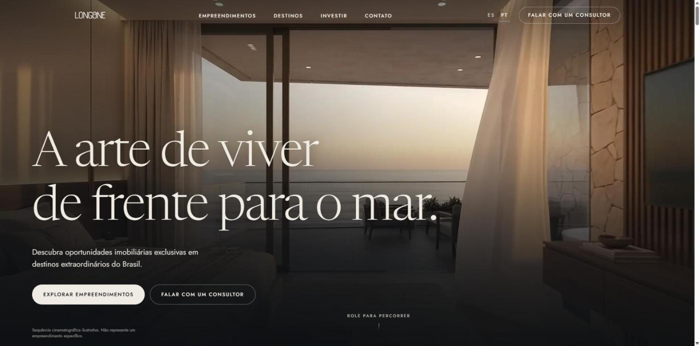
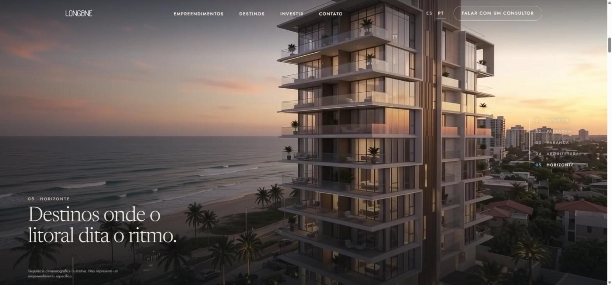
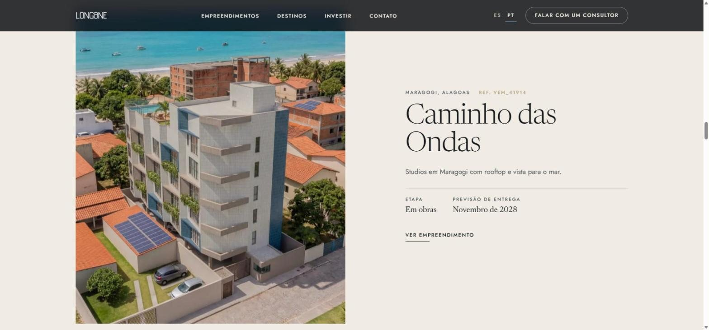
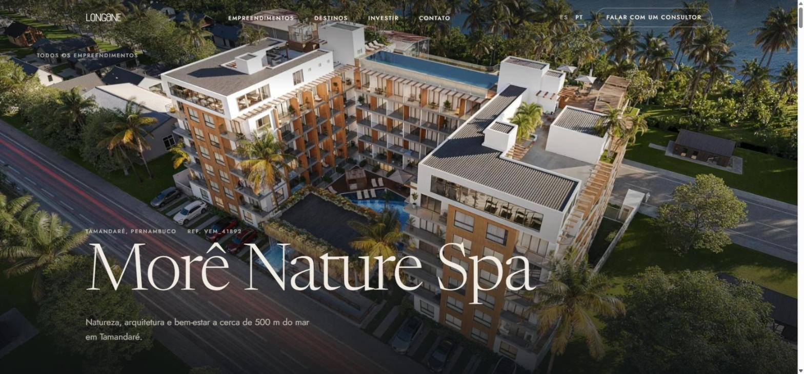
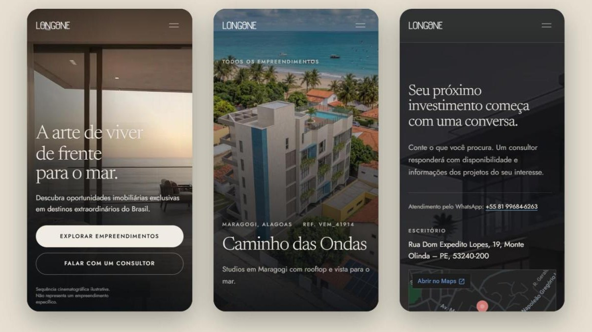

<div align="center">

<picture>
  <source media="(prefers-color-scheme: dark)" srcset="public/assets/brand/longone-wordmark-white.png">
  
</picture>

### *Beyond real estate.*

Proposta de redesign cinematográfico para a **Longone Inversiones Inmobiliárias**: imóveis no litoral do Nordeste brasileiro, em **espanhol** e **português**.

[](https://jhosuetortolero-lgtm.github.io/longone-inversiones/)
[](https://github.com/jhosuetortolero-lgtm/longone-inversiones/actions/workflows/deploy.yml)


**[🇪🇸 Español](https://jhosuetortolero-lgtm.github.io/longone-inversiones/es/) · [🇧🇷 Português](https://jhosuetortolero-lgtm.github.io/longone-inversiones/pt/)**

</div>

<br>



---

## ✦ A experiência

A home abre com um **filme controlado pelo scroll**. Os 190 quadros do vídeo original são desenhados num `<canvas>` e acompanham a rolagem. A câmera sai do quarto, atravessa a varanda, revela a fachada e se afasta até a vista aérea do litoral. Cinco capítulos de texto entram no ritmo da filmagem, e a sequência termina com a assinatura da marca.



| | |
|---|---|
| 🎬 **Filme no scroll** | Canvas + GSAP ScrollTrigger. Quadros carregados aos poucos (primeiro um a cada 16, até completar), cache com limite de memória e transição suave entre quadros. Celulares baixam uma versão mais leve. |
| 🌊 **Rolagem natural** | Inércia com Lenis sincronizada ao GSAP. No toque, o celular mantém o scroll nativo. Com "reduzir movimento" ativado, tudo vira imagem estática. |
| 🏛️ **Cinco empreendimentos** | Green Sea Oceanique · Caminho das Ondas · Morê Nature Spa · María Farinha Flats Residence · Green Sea Essence. Cada um tem página própria com ficha, tipologias, lazer, galeria com lightbox, plantas, localização e fontes. |
| 🌐 **Bilíngue de verdade** | Espanhol (padrão) e português, com URLs localizadas (`/es/emprendimientos/…`, `/pt/empreendimentos/…`), troca de idioma no menu e escolha lembrada. |
| 💬 **Contato pelo WhatsApp** | O formulário abre o WhatsApp com todos os dados preenchidos: nome, país, idioma, e-mail, telefone com DDI do país escolhido, empreendimento e mensagem. |
| 📍 **Escritório no mapa** | Rua Dom Expedito Lopes, 19, Monte, Olinda – PE, com mapa e alfinete. |
| 🔎 **SEO completo** | Páginas pré-renderizadas em HTML, com título, descrição, `canonical`, `hreflang`, Open Graph, JSON-LD, `sitemap.xml` e `robots.txt`. |
| 📱 **Responsivo** | Layouts próprios para celular, tablet e desktop, verificados no navegador. |

<br>

### Empreendimentos: edição editorial, não um grid de cards



### Página de cada empreendimento



### No celular

<p align="center">
  
</p>

---

## ✦ Identidade visual

| Elemento | Escolha |
|---|---|
| **Logo** | Arte original da Longone, separada do fundo azul sem redesenho (`scripts/process-logo.py`), em versões branca, escura e colorida |
| **Paleta** | Obsidiana `#0d1013` · Grafite `#232a30` · Marfim `#f1ece3` · Arenito `#b9a385` · Champanhe `#d8c6a2` · **Azul Longone** `#2e86d9` como acento |
| **Tipografia** | *Newsreader* (serifada editorial, títulos) + *Jost* (geométrica, ecoa o logotipo), ambas hospedadas no próprio site |
| **Detalhe de marca** | Os marcadores quadrados azuis repetem o pequeno quadrado do símbolo Longone |

---

## ✦ Stack

```
React 19 · TypeScript (strict) · Vite 6 · React Router 7
GSAP 3 + ScrollTrigger · Lenis · CSS com design tokens
Pré-renderização estática (SSR → HTML) · GitHub Actions → GitHub Pages
```

## ✦ Rodar localmente

```bash
npm install
npm run dev            # desenvolvimento: http://localhost:5173/es/
npm run build          # typecheck → build → SSR → pré-renderização (dist/)
npm run preview        # servir o build: http://localhost:4173/es/
npm run check:routes   # verifica rotas, SEO e arquivos referenciados
npm run lint
```

> Requer Node 20 ou mais recente. As ferramentas de mídia, opcionais, usam ffmpeg e Python com Pillow e numpy.

## ✦ Deploy (GitHub Pages)

Cada push na branch `main` dispara o workflow [`deploy.yml`](.github/workflows/deploy.yml). Ele:

1. instala as dependências (`npm ci`);
2. gera o build para o subcaminho do Pages (`BASE_PATH=/longone-inversiones/`);
3. roda o lint e a verificação de rotas: **se algo quebrar, o site não é publicado**;
4. publica a pasta `dist/` no GitHub Pages.

O site funciona tanto na raiz de um domínio (`BASE_PATH=/`) quanto num subcaminho. Todos os caminhos de arquivos e links passam por `src/lib/base.ts`.

## ✦ Configuração

| Variável | Uso |
|---|---|
| `BASE_PATH` | Subcaminho do deploy (`/` ou `/<repo>/`) |
| `VITE_SITE_URL` | URL pública, usada em `canonical`, `hreflang`, sitemap e Open Graph |
| `VITE_CONTACT_WHATSAPP` | Número que recebe o formulário. Padrão: `5581996846263` |
| `VITE_CONTACT_ENDPOINT` | (opcional) CRM ou webhook que recebe o formulário em JSON |
| `VITE_CONTACT_EMAIL` | (opcional) e-mail oficial |
| `VITE_NOINDEX` | `1` pede aos buscadores que não indexem o site. É assim nesta demonstração |

## ✦ Estrutura

```
src/
├─ data/          base de empreendimentos, destinos, países/DDI, contato, mídia gerada
├─ i18n/          todos os textos em ES e PT
├─ lib/           frameSequence (filme), smoothScroll, head (SEO), base (subcaminho)
├─ sections/      filme, introdução, empreendimentos, destinos, investir, contato
├─ pages/         Home, Empreendimento, Créditos, 404
└─ styles/        tokens, base, layout, home, páginas
scripts/          logo, quadros do vídeo, imagens, pré-renderização, verificação
docs/             relatório final, verificação de fontes, manifesto de imagens
```

## ✦ Dados, fontes e direitos

- Nenhum preço, rentabilidade ou promessa de valorização é publicado. Etapas e datas seguem as fontes oficiais. Quando as fontes divergem, o valor não é publicado ou fica sinalizado. Veja [`docs/SOURCE-VERIFICATION.md`](docs/SOURCE-VERIFICATION.md).
- As **imagens dos empreendimentos pertencem às incorporadoras e aos seus autores**. Aqui são usadas para apresentação, e o uso comercial público exige autorização. A lista completa está em [`docs/IMAGE-MANIFEST.md`](docs/IMAGE-MANIFEST.md).
- As fotos de destinos vêm do Wikimedia Commons, com licenças livres e créditos no próprio site (`/creditos`).
- A sequência cinematográfica é ilustrativa e não representa um empreendimento específico.

## ✦ Documentação

- [`docs/FINAL-REPORT.md`](docs/FINAL-REPORT.md): o que foi entregue, testes e pendências
- [`docs/SOURCE-VERIFICATION.md`](docs/SOURCE-VERIFICATION.md): auditoria de cada informação publicada
- [`docs/IMAGE-MANIFEST.md`](docs/IMAGE-MANIFEST.md): origem e direitos de cada imagem
- [`docs/DEVELOPMENT.md`](docs/DEVELOPMENT.md): guia técnico (em inglês)

<br>

<div align="center">
<sub>Proposta conceitual de redesign para a Longone Inversiones Inmobiliárias. Site de demonstração, não oficial.</sub>
</div>
